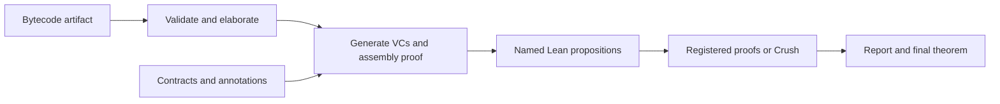

# Verification flow

Design: 2026-11-04. This is the proposed interface and architecture, not an
implemented verifier. It refines the [prototype roadmap](PROTOTYPE.md) and updates
the earlier reconstruction-only policy to support explicit solver trust.

**Implementation status:** the [first bytecode slice](BYTECODE.md) now implements
scalar reference semantics, a conservative baseline decoder, shallow command
translation, and the `bytecode%` elaborator with decoding/representation
certificates. It does not yet provide full artifact admission, specifications,
VC generation, or the proof registry below.

## 1. Inputs and embedding

The verifier takes an **externally generated bytecode artifact** plus a
**specification with verification annotations**. Source compilation/extraction is
outside the verifier. The artifact must include the CPython version/profile,
bytes, constants, code-object metadata, and any required environment bindings;
instruction bytes alone are insufficient. Source locations are optional.

Specifications are the inputs; verification conditions (VCs) are generated from
the program and those specifications. Both have a Lean DSL elaborated into our
formal semantic interface:

- **Program:** a shallow embedding into Lean semantic combinators for instructions
  and blocks. A block transforms explicit VM state and transfers control by
  continuing at a label, returning, or raising; later it may suspend. Control-flow
  cycles are interpreted by the execution relation, not forced into terminating
  Lean recursion. Python operations retain their modeled dynamic semantics.
- **Specification:** native Lean predicates for preconditions, normal/exceptional
  postconditions, cutpoint invariants, and optional ranking functions, with ghost
  parameters for initial inputs/state. Later add heap footprints and trace contracts.

Raw bytecode and its reference semantics remain the anchor. This is a hybrid:
the proof-facing program is shallow, while the original artifact is retained as
data. Elaboration must produce a **checked representation theorem** connecting the
shallow program to that artifact. Splitting fused instructions or normalizing
control flow requires proved correspondence, including relevant termination and
error behavior. Producing a new Lean algorithm with similar intent is insufficient.

## 2. Generation and soundness



Validate decoding, stack/control-flow structure, metadata, and supported features
before verification. Symbolically execute blocks using proved semantic rules.
Cutpoint invariants summarize cycles; check that the cutpoints cover every cycle
handled by the loop rule. Missing annotations are actionable diagnostics.

Generate obligations for entry/invariant initialization, preservation along all
edges, normal and exceptional exits, and execution safety. Total-correctness mode
also generates well-founded decrease obligations. Partial correctness permits
divergence but excludes stuck/unsupported execution. Summaries of dependencies
must be proved or retained as explicit premises.

Each VC is a **closed Lean proposition**, universally quantifying its symbolic
state, ghost values, and hypotheses. Use named proposition definitions until
proofs exist; only discharged VCs become theorem declarations. Generation also
constructs a proof of the schematic statement:

```text
validated artifact
  -> checked representation of artifact by program
  -> proofs of every generated obligation
  -> program satisfies specification under the artifact semantics
```

The generator is a proof-producing elaborator applying proved rules. The kernel
checks the assembled theorem against the original artifact/specification; reporting
that some collection of SMT queries succeeded is not the soundness argument.

## 3. Automated discharge and configuration

Resolve each VC with an explicitly registered proof first, then try Crush on
unresolved obligations. Registration is the user's override; a failed override
gets a diagnostic rather than being silently ignored. Keep backend, timeout, and
trust policy configurable per run, with explicit per-obligation overrides.

| Policy | Crush setting | Accepted evidence |
| --- | --- | --- |
| `checked` (default) | `crush.trust "reconstruct"` | Reconstructed Lean proof or supplied proof using only the approved axioms |
| `solver_trusted` | `crush.trust "trust"` | May use `Crush.crushSorry`; result explicitly records that dependency |

Do not silently downgrade after reconstruction failure. `sat`, `unknown`, timeout,
unsupported translation, and reconstruction failure remain distinguishable pending
results. An SMT model is a candidate about the encoding, not automatically a
counterexample to the Lean theorem. One solver failure must not stop other VCs.

Audit the complete proof dependency closure, including supplied proofs. Reject
`sorryAx` in either mode; permit `Crush.crushSorry` only under explicit solver trust.
Keep other nonstandard axioms outside the default policy. The actual dependencies
determine assurance: a trusted-mode call can still produce a checked proof, while
a supplied theorem using solver trust is not upgraded by being labeled manual.

## 4. Manual proof handoff

Separate generated goals, user proofs, and final verification to avoid circular
imports. Suggested files:

```text
Generated/Demo.lean  artifact, embedding, spec, VC propositions, assembly theorem
Proofs/Demo.lean     imports Generated; contains user-owned proofs
Verify/Demo.lean     imports both; resolves VCs, reports, assembles final theorem
```

For a pending obligation, print/export its **complete theorem statement** and
required imports, with all binders and hypotheses, no omitted terms or unresolved
metavariables. Include its bytecode location, obligation kind, and failure reason.
Provide an expanded statement even when a short named proposition is available.
Unfinished templates belong in diagnostic output, not automatically imported files.

Proposed attribute syntax (not yet implemented):

```lean
-- Generated/Demo.lean
def Demo.VC.exit_zero : Prop :=
  ∀ n : Int, 0 ≤ n → ¬ (0 < n) → n = 0

-- Proofs/Demo.lean, importing the generated module and Lean tactics
@[veripy_proof Demo.VC.exit_zero]
theorem Demo.exit_zero_manual :
    ∀ n : Int, 0 ≤ n → ¬ (0 < n) → n = 0 := by
  intro n hn hexit
  omega
```

The attribute indexes a proof by obligation name. Let `T` be the complete closed
type of the supplied theorem and `G` the generated VC. Registration must produce
and kernel-check this exact-match certificate:

```lean
show T = G from rfl
```

Here `T` and `G` denote propositions. `rfl` checks statement identity up to Lean's
definitional equality (including unfolding a named VC); it is not a restriction
on the supplied theorem's proof body. Audit that proof's axioms separately.
Do not use logical-equivalence lemmas, simplification, solver calls, weakening,
or implicit theorem specialization to establish a match. Compare all binders and
hypotheses, reject unresolved metavariables, and reject ambiguous duplicate
registrations. Users must explicitly wrap a more general lemma in a theorem of
the exact required type. “Manual” means user-supplied; its body may use any tactics
allowed by the selected trust policy.

Use readable IDs based on function, cutpoint/edge, and obligation kind, plus a
fingerprint of the artifact, elaborated specification/VC, semantics/generator
versions, and imported dependencies. IDs locate obligations; they never authorize
proof reuse by themselves. Recheck proofs when inputs change and invalidate stale
cached results. Generated files must not overwrite user proof files.

## 5. Output and completion

Emit Lean diagnostics and a machine-readable per-VC report: ID/location, exact
goal, theorem name, proof provider, actual solver/reconstruction path when known,
assurance, axiom dependencies, time, and failure details. Record backend events;
do not infer solver execution or Alethe success from configuration alone. If an
internal route is unavailable, report it as unknown.

```text
loop6.init      Proved via Crush/cvc5     [checked]
loop6.preserve  Proved manually          [checked: Demo.preserve]
loop6.exit      Discharged via Crush/z3  [solver-trusted: Crush.crushSorry]
loop6.decrease  Pending                  [reconstruction failed; theorem exported]
```

A discovery/report run may complete with pending goals and exports no unconditional
correctness theorem. It may expose the assembly theorem conditional on those VCs.
A final verification run fails if any obligation is unresolved or violates policy.
If all resolve, emit the final theorem and aggregate assurance: **checked** only
when every dependency satisfies checked policy; otherwise **solver-trusted** with
the added assumption visible. Do not describe either as a proof of CPython's C
implementation; runtime correspondence remains a separate boundary.

## 6. Extension to real-world and async code

Keep VM state, effects, and resumable continuations explicit in the semantic
combinators. Extend contracts and VC rules for heap mutation, calls, exceptions,
and then coroutine/scheduler transitions. The same proof registry and report
format can serve all these obligations.

Async safety quantifies over the admitted schedules; prove transition-invariant
obligations and assemble them using an execution-induction rule. Liveness needs
separate temporal/progress rules and explicit fairness/environment assumptions.
Crush may discharge their local logical obligations; it does not supply a
scheduler model or turn a sequential termination proof into an async liveness proof.

Implementation order: artifact/representation boundary; spec DSL and sound block
rules; closed VC definitions and conditional assembly; keyed proof registration
and reporting; Crush adapter with both trust policies; whole-program assembly.

## 7. Metatheory
We want to study the meta-theory of our verification workflow and our formalization. The meta-theory concerns the soundness of our proof system. We want to formalize a soundness theorem for it, i.e., If our proof system says the code is correct, then semantically, the code satisfies the property. We will work on the formalization later. 
