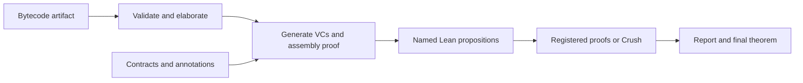

# Verification flow

Design: 2026-11-04. This is the proposed interface and architecture, not an
implemented verifier. It refines the [prototype roadmap](PROTOTYPE.md) and updates
the earlier reconstruction-only policy to support explicit solver trust.

**Implementation status:** the [first bytecode slice](BYTECODE.md) now implements
scalar reference semantics, a conservative baseline decoder, shallow command
translation, and the `bytecode%` elaborator with decoding/representation
certificates. `admit_bytecode%` additionally produces a stack certificate bound to
the exact decoded code and declared capacity, with stack-safety proofs for every
fuel bound. Fused local instructions and extended operands are supported; the
compiled `triangular` loop is stack-admitted and has a universal total-correctness
proof for nonnegative integer inputs. Generic value-tag/local-initialization
analysis and full artifact admission remain separate work. The
[native contract interface](CONTRACTS.md) now defines partial and total
correctness, relates finite execution to the runner, and transports correctness
to raw artifacts. Imported `add1` has a universal integer total-correctness proof.
Scoped Hoare notation supports frame pre/postconditions for both correctness modes.
The [instruction, block, and loop rules](RULES.md) distinguish continuing, returned, and
exceptional outcomes, prove composition sound against the machine semantics,
and derive the imported `add1` and `triangular` theorems. Default admission also
checks a separate ownership certificate: borrowed stack values cannot outlive
their supporting locals or be stored into locals, including within fused stores.
The value semantics erases ownership; its runtime interpretation requires this
protocol and the external runtime-correspondence assumptions. Loop rules require a
nonempty iteration, invariant preservation, and, for total correctness, a
terminating iteration with strict decrease in a well-founded relation.
The triangular example now exposes four named, closed VCs and a conditional
artifact-correctness assembly theorem, with ordinary Lean proofs supplied
separately. The optional `TriangularCrush` target supplies checked Crush proofs
of the same VCs and assembles the same artifact contract. These VCs are extracted
by hand from the proved block summaries.
`VerifiedArtifact` now combines stack/ownership admission, partial or total
correctness, and a proof that every contract pre-state satisfies the certificates'
call-entry domain. The existing artifact judgments remain lower-level interfaces.
The shared `AxiomAudit` now rejects unexpected transitive axioms in core/example
exports and the CI audit, including definitions containing certificates.
`make check` covers all project modules, regression libraries, and the CPython harness.
Exact proof registration is implemented in `Verification/VC/Registry.lean`:
`@[veripy_proof Goal]` kernel-checks and retains the statement equality certificate,
audits the proof, and rejects duplicates. Imported proofs are rechecked at use.
`Verification/VC/Manifest.lean`, `Report.lean`, and `Discharge.lean` now implement
manifest validation, discovery, exact statement emission, per-obligation reports,
and final package assembly. The core resolves registered proofs without importing
Crush; an optional adapter supplies automation.
The full specification DSL and automatic VC generation remain future work.

## 1. Inputs and embedding

The verifier takes an **externally generated bytecode artifact** plus a
**specification with verification annotations**. Source compilation/extraction is
outside the verifier. The artifact must include the CPython version/profile,
bytes, constants, code-object metadata, and any required environment bindings;
instruction bytes alone are insufficient. Source locations are optional.

Specifications are the inputs; verification conditions (VCs) are generated from
the program and those specifications. Both have a Lean DSL elaborated into our
formal semantic interface:

- **Program:** a shallow embedding into Lean semantic combinators for instructions
  and blocks. A block transforms explicit VM state and transfers control by
  continuing at a label, returning, or raising; later it may suspend. Control-flow
  cycles are interpreted by the execution relation, not forced into terminating
  Lean recursion. Python operations retain their modeled dynamic semantics.
- **Specification:** native Lean predicates for preconditions, normal/exceptional
  postconditions, cutpoint invariants, and optional ranking functions, with ghost
  parameters for initial inputs/state. Later add heap footprints and trace contracts.

Raw bytecode and its reference semantics remain the anchor. This is a hybrid:
the proof-facing program is shallow, while the original artifact is retained as
data. Elaboration must produce a **checked representation theorem** connecting the
shallow program to that artifact. Splitting fused instructions or normalizing
control flow requires proved correspondence, including relevant termination and
error behavior. Producing a new Lean algorithm with similar intent is insufficient.

The current reference step groups `EXTENDED_ARG` prefixes with their terminal
opcode and caches, and executes compiler-fused local operations atomically.
Fuel counts decoded groups. The exact shallow/reference equality is relative to
this model; correspondence to CPython's internal dispatches remains separate.

## 2. Generation and soundness



Validate decoding, stack/control-flow structure, ownership lifetimes, metadata, and supported features
before verification. Symbolically execute blocks using proved semantic rules.
Cutpoint invariants summarize cycles; check that the cutpoints cover every cycle
handled by the loop rule. Missing annotations are actionable diagnostics.

Generate obligations for entry/invariant initialization, preservation along all
edges, normal and exceptional exits, and execution safety. Total-correctness mode
also generates well-founded decrease obligations. Partial correctness permits
divergence but excludes stuck/unsupported execution. Summaries of dependencies
must be proved or retained as explicit premises.

Each VC is a **closed Lean proposition**, universally quantifying its symbolic
state, ghost values, and hypotheses. Use named proposition definitions until
proofs exist; only discharged VCs become theorem declarations. Generation also
constructs a proof of the schematic statement:

```text
validated artifact
  -> checked representation of artifact by program
  -> proofs of every generated obligation
  -> program satisfies specification under the artifact semantics
```

The generator is a proof-producing elaborator applying proved rules. The kernel
checks the assembled theorem against the original artifact/specification; reporting
that some collection of SMT queries succeeded is not the soundness argument.

The current hand-extracted instance lives in `Examples/Triangular/VC.lean` and
`Assembly.lean`: `Triangular.Assembly.artifact_total` takes `VC.Proofs` and proves
`ArtifactTotalCorrect triangularArtifact triangularContract`. It imports no proof
provider. Instruction safety and finite execution of each iteration are already
proved in `Blocks.lean`; initialization, invariant preservation, exit, and strict
ranking are explicit residual premises. See the [contract guide](CONTRACTS.md).

## 3. Automated discharge and configuration

Resolve each VC with an explicitly registered proof first, then try Crush on
unresolved obligations. Registration is the user's override; a failed override
gets a diagnostic rather than being silently ignored. Keep backend, timeout, and
trust policy configurable per run, with explicit per-obligation overrides.

| Policy | Crush setting | Accepted evidence |
| --- | --- | --- |
| `checked` (default) | `crush.trust "reconstruct"` | Reconstructed Lean proof or supplied proof using only the approved axioms |
| `solver_trusted` | `crush.trust "trust"` | May use `Crush.crushSorry`; result explicitly records that dependency |

Do not silently downgrade after reconstruction failure. `sat`, `unknown`, timeout,
unsupported translation, and reconstruction failure remain distinguishable pending
results. An SMT model is a candidate about the encoding, not automatically a
counterexample to the Lean theorem. One solver failure must not stop other VCs.

Audit the complete proof dependency closure, including supplied proofs. Reject
`sorryAx` in either mode; permit `Crush.crushSorry` only under explicit solver trust.
Keep other nonstandard axioms outside the default policy. The actual dependencies
determine assurance: a trusted-mode call can still produce a checked proof, while
a supplied theorem using solver trust is not upgraded by being labeled manual.

The implemented `#veripy_audit Namespace` command enforces checked policy only:
the allowlist is `propext`, `Classical.choice`, and `Quot.sound`. It fails on
unknown declarations and audits safe definitions as well as theorems, including
private dependencies. Unsafe/partial metaprograms are not accepted as proof
evidence. VC registration/discharge uses the separate `VC.Policy` interface for
explicit solver trust; the namespace audit never implicitly allows Crush's axiom.

### Implemented commands

The generated-side module declares closed VCs and a proof structure, supplies a
conditional assembly function, then lists every field in constructor order:

```lean
import VeriPyAsm.Examples.Triangular.Manifest
import VeriPyAsm.Verification.VC.Discharge

-- The imported manifest was declared with:
-- veripy_vcs obligations : VerifiedArtifact triangularArtifact triangularContract
--     via Assembly.verified where
--   init : VC.loop6.init at 6 vc_kind "initialization"
--   preserve : VC.loop6.preserve at 6 vc_kind "preservation"
--   exit : VC.loop6.exit at 58 vc_kind "normal_exit"
--   decrease : VC.loop6.decrease at 6 vc_kind "ranking"

set_option veripy.auto false in
veripy_discover exploration from VeriPyAsm.Examples.Triangular.obligations

#veripy_report exploration.report
```

Discovery emits proved VC declarations and `exploration.report`, but no final
artifact package. Pending goals include full, parseable statements, imports,
byte offsets, kinds, and reasons. After importing registered proofs, use
`veripy_verify verified from ...` to create the final `verified : VerifiedArtifact ...`
and `verified.report`. An incomplete strict run fails and rolls back all generated
declarations. Reports are Lean data; `#veripy_report name.report` emits JSON.
`set_option veripy.json true` also includes JSON in diagnostics, including failures.

Run options are `veripy.policy` (`"checked"` by default, or `"solver_trusted"`),
`veripy.backend` (`"cvc5"`, `"z3"`, or `"bitwuzla"`), `veripy.timeout` (positive
seconds, default 5), and `veripy.auto` (default true). Per-goal overrides follow
the command, for example:

```lean
-- veripy_verify verified from obligations with
--   VC.loop6.exit (backend := "z3") (timeout := 2) (policy := "checked")
```

The manifest currently accepts a closed assembly function taking a single,
unparameterized proof structure and returning `VerifiedArtifact`. It rejects
missing, reordered, mismatched, or dependent proof fields. Its assembly rules
must themselves pass checked policy. Each run recomputes a diagnostic fingerprint
of transitive declaration content (including artifact, contract, VCs, and semantic
dependencies), workflow version, Lean version, and location metadata. This is not
a cryptographic cache key: no proof-result cache is implemented, and every use is
checked again regardless of the fingerprint.

## 4. Manual proof handoff

Separate generated goals, user proofs, and final verification to avoid circular
imports. Suggested files:

```text
Generated/Demo.lean  artifact, embedding, spec, VC propositions, assembly theorem
Proofs/Demo.lean     imports Generated; contains user-owned proofs
Verify/Demo.lean     imports both; resolves VCs, reports, assembles final theorem
```

For a pending obligation, print/export its **complete theorem statement** and
required imports, with all binders and hypotheses, no omitted terms or unresolved
metavariables. Include its bytecode location, obligation kind, and failure reason.
Provide an expanded statement even when a short named proposition is available.
Unfinished templates belong in diagnostic output, not automatically imported files.

Implemented attribute syntax:

```lean
-- Generated/Demo.lean
def Demo.VC.exit_zero : Prop :=
  ∀ n : Int, 0 ≤ n → ¬ (0 < n) → n = 0

-- Proofs/Demo.lean, importing the generated module and Lean tactics
@[veripy_proof Demo.VC.exit_zero]
theorem Demo.exit_zero_manual :
    ∀ n : Int, 0 ≤ n → ¬ (0 < n) → n = 0 := by
  intro n hn hexit
  omega
```

The attribute indexes a proof by obligation name. Let `T` be the complete closed
type of the supplied theorem and `G` the generated VC. Registration must produce
and kernel-check this exact-match certificate:

```lean
show T = G from rfl
```

Here `T` and `G` denote propositions. `rfl` checks statement identity up to Lean's
definitional equality (including unfolding a named VC); it is not a restriction
on the supplied theorem's proof body. Audit that proof's axioms separately.
The default registration policy is checked. The explicit form
`@[veripy_proof Goal solver_trusted]` permits `Crush.crushSorry`; a later checked
run still rejects such a proof. Registration currently requires closed proposition
definitions and theorem types without universe parameters. Wrap polymorphic
schemas in closed VCs first. The certificate is named `theoremName.veripy_match`.
Do not use logical-equivalence lemmas, simplification, solver calls, weakening,
or implicit theorem specialization to establish a match. Compare all binders and
hypotheses, reject unresolved metavariables, and reject ambiguous duplicate
registrations. Users must explicitly wrap a more general lemma in a theorem of
the exact required type. “Manual” means user-supplied; its body may use any tactics
allowed by the selected trust policy.

Use readable IDs based on function, cutpoint/edge, and obligation kind, plus a
fingerprint of the artifact, elaborated specification/VC, semantics/generator
versions, and imported dependencies. IDs locate obligations; they never authorize
proof reuse by themselves. Recheck proofs when inputs change and invalidate stale
cached results. Generated files must not overwrite user proof files.

## 5. Output and completion

Emit Lean diagnostics and a machine-readable per-VC report: ID/location, exact
goal, theorem name, proof provider, actual solver/reconstruction path when known,
assurance, axiom dependencies, time, and failure details. Record backend events;
do not infer solver execution or Alethe success from configuration alone. If an
internal route is unavailable, report it as unknown.

```text
loop6.init      Proved via Crush/cvc5     [checked]
loop6.preserve  Proved manually          [checked: Demo.preserve]
loop6.exit      Discharged via Crush/z3  [solver-trusted: Crush.crushSorry]
loop6.decrease  Pending                  [reconstruction failed; theorem exported]
```

A discovery/report run may complete with pending goals and exports no unconditional
correctness theorem. It may expose the assembly theorem conditional on those VCs.
A final verification run fails if any obligation is unresolved or violates policy.
If all resolve, emit the final theorem and aggregate assurance: **checked** only
when every dependency satisfies checked policy; otherwise **solver-trusted** with
the added assumption visible. Do not describe either as a proof of CPython's C
implementation; runtime correspondence remains a separate boundary.

The final public result must be a `VerifiedArtifact` package, including its
admission and entry-compatibility proofs. A standalone `ArtifactTotalCorrect`
or `ArtifactPartialCorrect` theorem does not meet this completion requirement.

## 6. Extension to real-world and async code

Keep VM state, effects, and resumable continuations explicit in the semantic
combinators. Extend contracts and VC rules for heap mutation, calls, exceptions,
and then coroutine/scheduler transitions. The same proof registry and report
format can serve all these obligations.

Async safety quantifies over the admitted schedules; prove transition-invariant
obligations and assemble them using an execution-induction rule. Liveness needs
separate temporal/progress rules and explicit fairness/environment assumptions.
Crush may discharge their local logical obligations; it does not supply a
scheduler model or turn a sequential termination proof into an async liveness proof.

Implementation order: artifact/representation boundary; spec DSL and sound block
rules; closed VC definitions and conditional assembly; keyed proof registration
and reporting; Crush adapter with both trust policies; whole-program assembly.

## 7. Metatheory
We want to study the meta-theory of our verification workflow and our formalization. The meta-theory concerns the soundness of our proof system. We want to formalize a soundness theorem for it, i.e., If our proof system says the code is correct, then semantically, the code satisfies the property. We will work on the formalization later. 
